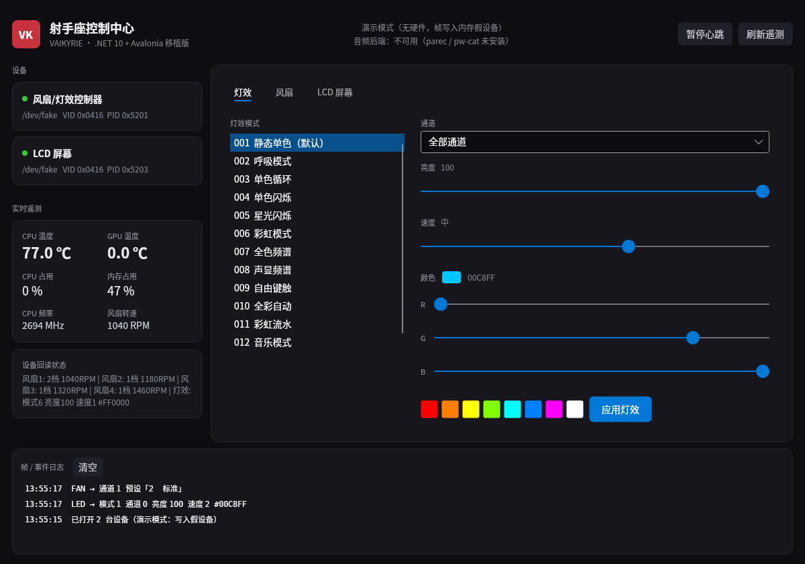

# VK 射手座控制中心 · Linux 移植

把 Windows 上的 `VAIKYRIE.exe`（.NET Framework 4.x / WinForms）逆向后，用 **.NET 10 + Avalonia**
重写成能在 Linux 上跑的等价控制中心：LCD 屏遥测、ARGB 灯效、四路风扇曲线、背景图/视频上传。

逆向出的完整线协议见 [`PROTOCOL.md`](PROTOCOL.md)。



## 目录

```
dotnet/
  src/VkSagittarius.Core/    协议 + hidraw 传输 + 遥测 + 音频电平 + U 盘上传 + 心跳引擎
  src/VkSagittarius.App/     Avalonia 界面（灯效 / 风扇 / LCD 三页 + 日志）
  tests/VkSagittarius.Tests/ 14 项单测（帧布局、负载字节序、状态解析、心跳调度）
  tools/Screenshot/          headless 渲染截图（无显示器环境验证 UI）
  dist/                      dotnet publish 产物（framework-dependent, linux-x64）
vksag/                       最早的 Python 参考实现（协议对照用，不参与构建）
decomp/  decomp-usbhid/      ilspycmd 反编译出的 C# 源码
app/                         原始 Windows 程序解包
screenshots/                 界面截图
packaging/                   udev 规则、desktop 入口、安装脚本
```

## 构建与运行

需要 .NET 10 SDK（`dotnet --version` ≥ 10.0）。

```bash
cd dotnet
dotnet build VkSagittarius.slnx
dotnet test tests/VkSagittarius.Tests        # 14 passed
dotnet run --project src/VkSagittarius.App   # 有设备则直连，无设备自动进演示模式
```

发布：

```bash
dotnet publish src/VkSagittarius.App -c Release -r linux-x64 --self-contained false -o dist
./dist/VkSagittarius.App            # 图形界面
./dist/VkSagittarius.App --self-test  # 无界面自检：枚举设备、发一轮帧、打印遥测
```

命令行参数：

| 参数 | 行为 |
|---|---|
| 无 | 打开 HID 设备；一个都打不开时退化为演示模式（写内存假设备） |
| `--demo` | 强制演示模式，界面完整可操作，帧不会真发 |
| `--self-test` | 不进图形界面，打印设备枚举、遥测、一轮 LED/FAN/LCD 发送结果 |
| `--headless [--seconds N]` | 常驻心跳：不开窗口，只跑 10Hz 音频帧 + 1Hz 状态回读 + 1Hz LCD 三段文本；N 秒后自退（验证用） |

## 权限

`/dev/hidraw*` 默认只有 root 可写。装 udev 规则即可免 sudo：

```bash
sudo install -m644 packaging/99-vk-sagittarius.rules /etc/udev/rules.d/
sudo udevadm control --reload && sudo udevadm trigger
```

规则内容（VID `0x0416`，PID `0x5201/0x5202/0x5203`）：

```
SUBSYSTEM=="hidraw", ATTRS{idVendor}=="0416", ATTRS{idProduct}=="5201", TAG+="uaccess", MODE="0660"
SUBSYSTEM=="hidraw", ATTRS{idVendor}=="0416", ATTRS{idProduct}=="5202", TAG+="uaccess", MODE="0660"
SUBSYSTEM=="hidraw", ATTRS{idVendor}=="0416", ATTRS{idProduct}=="5203", TAG+="uaccess", MODE="0660"
```

上传背景图还需要挂载能力：装了 `udisks2` 时普通用户即可；否则以 root 运行，
程序会退回 `mount -t vfat`。

## 与 Windows 版的行为差异

- **没有托盘图标与开机自启**：改为可选的 systemd user service（见 `packaging/`），
  界面关掉不影响已下发到设备的设置。
- **遥测来源**：WMI + `cpuidsdk.dll` 换成 `/proc`、`/sys/class/hwmon`、`nvidia-smi`；
  CPUID SDK 本身带试用期检查，移植后不再需要。
- **主板温度 / 内存温度**：Linux 侧普遍没有对应传感器，LCD 上这两项留空（设备显示 0）。
- **音频电平**：需要 `parec`（pulseaudio-utils）或 `pw-cat`（pipewire）；都没有时
  声显频谱类灯效会停在 0，其余功能不受影响。
- **心跳调度**：原程序三个 `System.Timers.Timer` 并发；移植版用一个 20ms 调度循环，
  LCD 三段文本排队发送（0/330/660ms），避免阻塞 10Hz 的音频帧。
- **多台同型号设备**：仍按类别分配序号（`cmd=1`）并写入帧头第 10 字节，
  但界面一次只操作每类的第一台。

## 已验证 / 未验证

已验证（在本机真实执行）：

- `dotnet build` 全解决方案 0 警告 0 错误；14 项单测全过。
- `--self-test` 枚举到宿主透出的 `Nuvoton HID Transfer`（`0x0416:0x5201`），
  读到了真实 CPU 温度 / 频率 / 风扇转速。
- Avalonia headless + Skia 渲染三页界面并落盘截图（`screenshots/`），中文正常。

未验证（缺硬件或缺少权限）：

- 与真实设备的写入路径：容器内 `/dev/hidraw0` 未映射（`errno=2`），
  因此只验证了帧字节与调度，没有验证设备实际响应。
- LCD 换图依赖设备切成 U 盘后由宿主枚举块设备，容器内无法完整走通。

真机首次验证建议顺序：`--self-test` → 灯效页改颜色 → 风扇页切预设 →
LCD 页旋转 90° → 最后再试上传背景。
